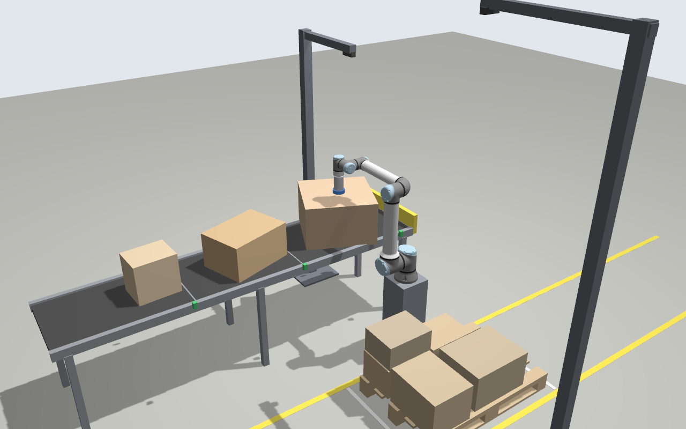
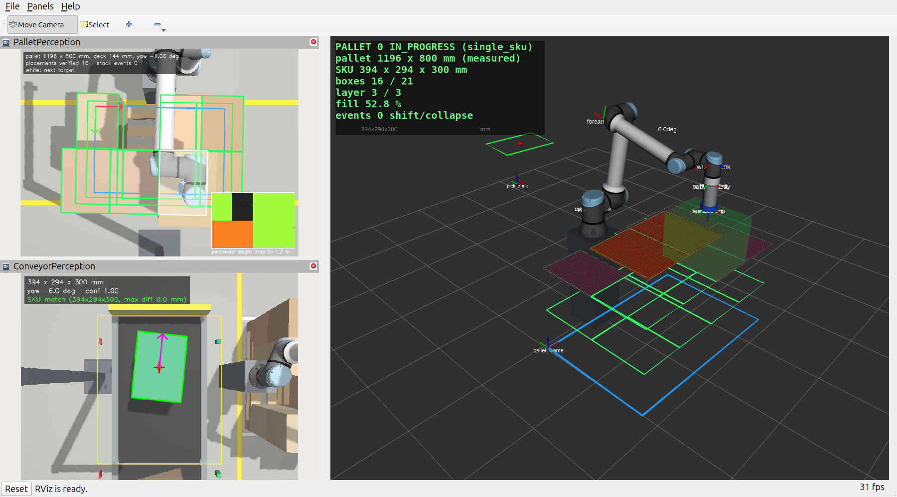

# Palletizer — autonomous palletizing cell (ROS 2 Jazzy, Gazebo Harmonic)

UR10e with a suction gripper, a zone conveyor with photo-eyes, a pallet conveyor with an
exchange station, and two overhead RGB-D cameras (conveyor pick zone, pallet station).
Nothing about boxes or pallets is configured into the robot: the conveyor camera measures
every box, the pallet camera measures every pallet that arrives, the stack as it grows and
every placement. Two modes:

- **single_sku**: boxes of one SKU are stacked in layer patterns (block-based search for the
  densest layer, interlocking A/B layers when possible); a pallet is FULL when the pattern is
  complete, the SKU changes, the height limit is reached or no placement is feasible; the
  orchestrator then runs the pallet-exchange handshake and continues on the new pallet.
- **mixed**: random boxes with the v1 planners (naive / heuristic + PyBullet check).

Perception → packing → MoveIt 2 (Pilz) pick & place, driven by a BehaviorTree.
Results: [docs/RESULTS.md](docs/RESULTS.md).





## Setup
```bash
sudo apt install ros-jazzy-ur-description ros-jazzy-ur-simulation-gz ros-jazzy-ros-gz \
  ros-jazzy-gz-ros2-control ros-jazzy-ros2-controllers ros-jazzy-moveit python3-scipy \
  ros-jazzy-rviz-2d-overlay-plugins ros-jazzy-behaviortree-cpp
cd ~/palletizer_ws
python3 -m venv --system-site-packages .venv && touch .venv/COLCON_IGNORE
source /opt/ros/jazzy/setup.bash
source .venv/bin/activate
pip install -r requirements.txt
python -m colcon build
source install/setup.bash
```

## Every new terminal
```bash
source /opt/ros/jazzy/setup.bash
source ~/palletizer_ws/.venv/bin/activate
source ~/palletizer_ws/install/setup.bash
```

## Run
Everything is headless by default (`gui:=false`); add `gui:=true` for the Gazebo GUI + RViz.
```bash
# demo: single-SKU palletizing with Gazebo GUI + RViz (debug images, status overlay)
ros2 launch palletizer_bringup palletizer.launch.py mode:=single_sku sku:=400x300x300 gui:=true

# SKU change mid-stream (the robot is not told): closes the pallet with SKU_CHANGE
ros2 launch palletizer_bringup palletizer.launch.py mode:=single_sku \
  order:="400x300x200:12, 600x400x300:20"

# a carton and a pallet the robot was never configured for (it measures both)
ros2 launch palletizer_bringup palletizer.launch.py mode:=single_sku sku:=347x253x219 \
  pallets:=1140x760x150

# other pallets in turn, operator-confirmed exchanges, interlocking priority
ros2 launch palletizer_bringup palletizer.launch.py mode:=single_sku sku:=520x320x250 \
  pallets:="EUR,1000x800,HALF" exchange_mode:=operator pattern_priority:=interlock
ros2 service call /pallet/confirm_exchange std_srvs/srv/Trigger     # operator: go
ros2 service call /pallet/close std_srvs/srv/Trigger                # operator: close now

# mixed boxes, v1 planners (mode:=auto is an alias of mixed)
ros2 launch palletizer_bringup palletizer.launch.py mode:=mixed planner:=heuristic
ros2 launch palletizer_bringup palletizer.launch.py mode:=mixed planner:=naive seed:=3

# stop after N pallets (optionally after the first box of the next one)
ros2 launch palletizer_bringup palletizer.launch.py mode:=single_sku sku:=600x400x300 \
  max_pallets:=1 finish_with_next_box:=true

# manual mode (everything except the orchestrator; a first pallet is delivered)
ros2 launch palletizer_bringup palletizer.launch.py

# view the behavior tree live: open Groot2 and connect to localhost:1667
```
SKU keys are the catalog entries in `cell_config.yaml` (`spawner.catalog`, read only by the
spawner); any other `LxWxH` in mm is taken literally. Pallet types: `EUR`, `1000x800`, `HALF`
(`exchanger.pallet_types`, read only by the pallet exchanger) or raw `LxWxH` mm.

## Manual commands
```bash
ros2 service call /box_spawner/spawn_box std_srvs/srv/Trigger
ros2 service call /perception/detect_box palletizer_interfaces/srv/DetectBox
ros2 service call /pallet_perception/measure_pallet palletizer_interfaces/srv/MeasurePallet
ros2 action send_goal /pallet_exchange palletizer_interfaces/action/PalletExchange "{}" -f
ros2 service call /conveyor_controller/resume std_srvs/srv/Trigger
ros2 service call /motion/park std_srvs/srv/Trigger
ros2 topic echo /pallet/status              # PalletStatus (transient local)
ros2 topic echo /pallet_perception/stack_events
ros2 topic echo /orchestrator/cycle_report
```

## Tests
```bash
src/palletizer_tools/test/run_all.sh            # build, no-hardcoding check, sim tests
python -m pytest src/palletizer_packing/test    # packing core + pattern planner
python -m pytest src/palletizer_perception/test # pallet detector on synthetic depth images
python -m pytest src/palletizer_tools/test/test_no_hardcoding.py

SIM_ARGS="seed:=42" src/palletizer_tools/test/sim_ctl.sh start  # sim for the tests below
ros2 run palletizer_perception eval_perception --n 60           # box perception vs ground truth
ros2 run palletizer_perception eval_pallet_perception           # pallet perception vs ground truth
python3 src/palletizer_perception/test/test_perception_touching.py
ros2 run palletizer_orchestrator pick_place_test --n 20         # 20-box pick & place acceptance
src/palletizer_tools/test/sim_ctl.sh stop
```

## Acceptance runs / benchmark
```bash
ros2 run palletizer_orchestrator sku_runs                       # one pallet per catalog SKU
ros2 run palletizer_orchestrator sku_runs --name skuchange --order "400x300x200:10, 600x400x300:4"
ros2 run palletizer_orchestrator sku_runs --name unknown --sku 347x253x219 --pallets 1140x760x150
ros2 run palletizer_orchestrator sku_runs --summary-only        # rebuild the RESULTS.md table
ros2 run palletizer_orchestrator benchmark --planners naive heuristic --seeds 1 2 3 4 \
  --prefix v2bench                                              # mixed mode (v1 planners)
```

## Offline tools
```bash
ros2 run palletizer_motion build_reachability_map    # station-area map; needs move_group running
ros2 run palletizer_packing pattern_report           # layer patterns of the catalog on EUR
```
