# Palletizer

**An autonomous palletizing cell in ROS 2: it measures every carton and every pallet with
its cameras, plans interlocked layer patterns, and stacks pallet after pallet with a UR10e.**

[](https://docs.ros.org/en/jazzy/)
[](https://gazebosim.org/docs/harmonic/)
[](https://moveit.ai/)
[](https://www.behaviortree.dev/)
[](https://github.com/JaisalJain/palletizer/actions/workflows/tests.yml)
[](https://github.com/JaisalJain/palletizer/actions/workflows/build.yml)
[](LICENSE)


## Highlights

- 📦 **Nothing about boxes or pallets is configured.** Box dims error ≤ 0.31 mm, pallet ≤ 3.1 mm (in sim).
- 🧱 **9/9 catalog cartons + an unseen 347×253×219 on an unseen pallet**, full pallets, 0 collapses.
- ⚡ **4.3–4.9 picks/min** per single-SKU pallet; mixed boxes 3.2–3.9 (v1: 1.8–2.1): the next placement is planned during the pick.
- 🧩 **Interlocked layer patterns**: guillotine + 5-block search, 100 % bridging for 520×320 and 500×300.
- 🔄 **Pallet-exchange handshake**: FULL → EXCHANGING → READY → measured, auto or operator-confirmed.
- 🎯 **Camera-verified placements**: ≤ 0.67 mm vs ground truth; a 40 mm shove is reported as 39.9 mm.

<table>
  <tr>
    <td width="50%">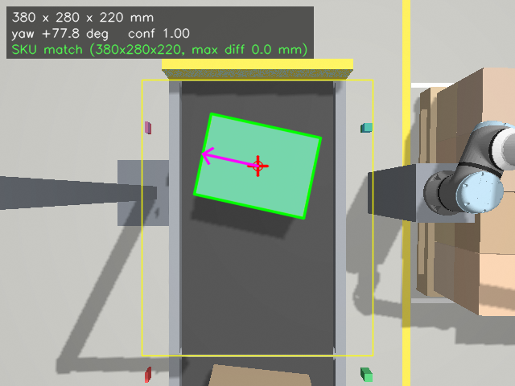</td>
    <td width="50%">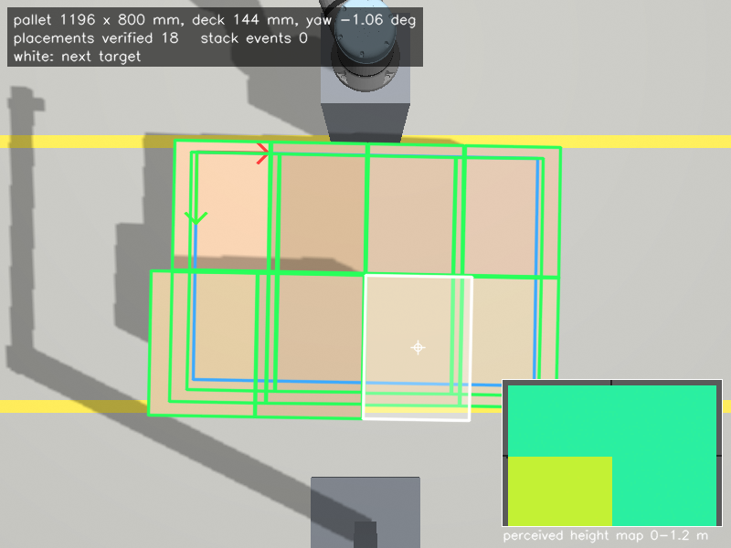</td>
  </tr>
  <tr>
    <td><b>Conveyor camera</b>: carton size, yaw and grasp point</td>
    <td><b>Pallet camera</b>: pallet, stack height map, placement checks</td>
  </tr>
  <tr>
    <td>
      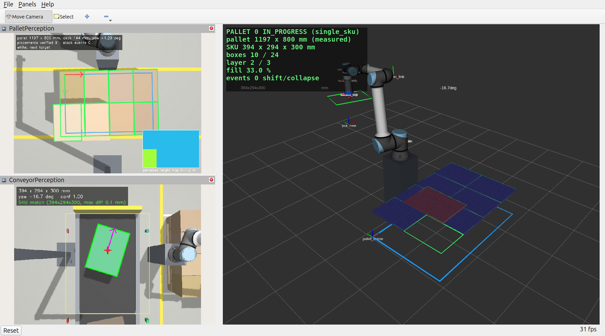
    </td>
    <td>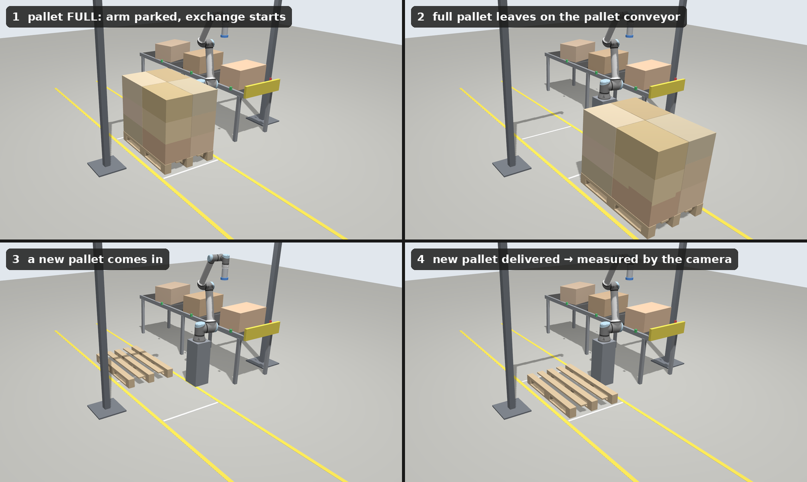</td>
  </tr>
  <tr>
    <td><b>RViz</b>: 3D scene, both perception panels, status overlay</td>
    <td><b>Pallet exchange</b>: full pallet out, new pallet in</td>
  </tr>
</table>

## How it works

Two RGB-D cameras measure; a pattern planner picks the slot on the *perceived* stack; MoveIt 2
picks at the top-face centre and places. A BehaviorTree runs the loop and the pallet exchange.

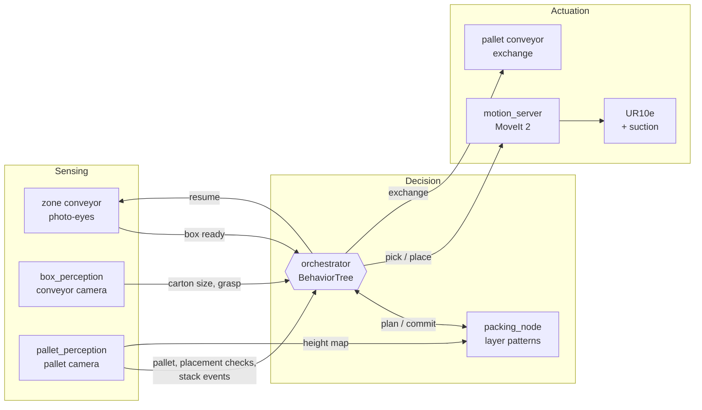

<p align="center">
  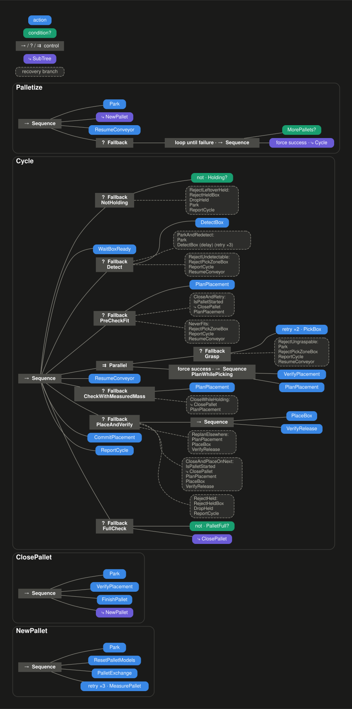
</p>

## Layer patterns and finished pallets

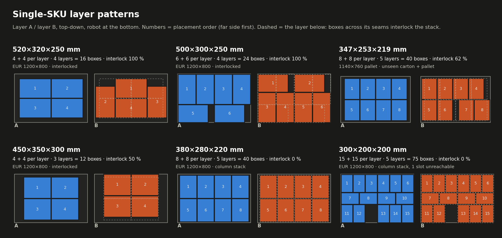

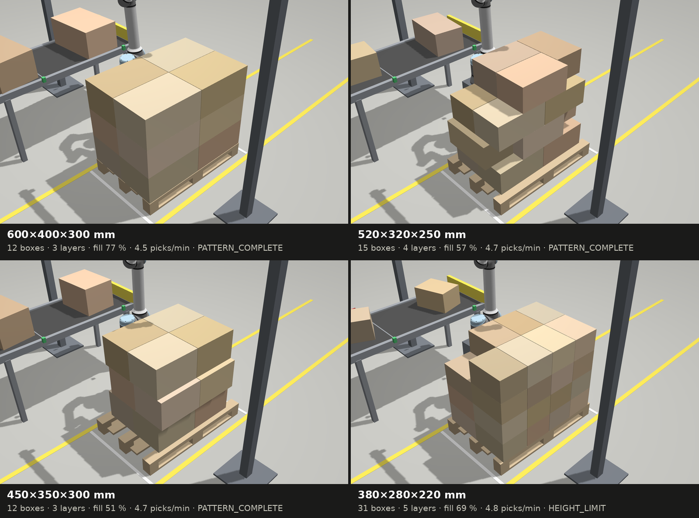

## Warehouse world

`world:=warehouse` puts the same cell inside a warehouse modelled procedurally in Blender from
`cell_config.yaml`: racking, dock doors with a trailer, an infeed line, a stretch wrapper and
safety fencing with light curtains. It is set dressing only. Nothing enters the robot's reach,
the pallet lane, the photo-eye beams or the cameras' ROIs (checked by a keep-out verifier), and
the roof and walls cast no shadows. The default `world:=plain` is unchanged. Rebuild it with
[tools/warehouse_blender](tools/warehouse_blender/README.md).

<table>
  <tr>
    <td width="50%">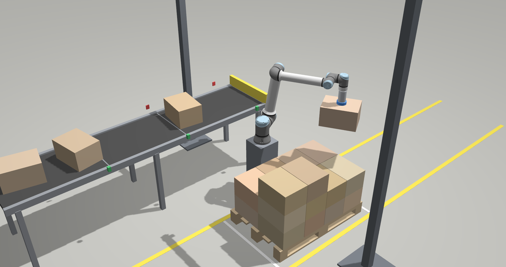</td>
    <td width="50%">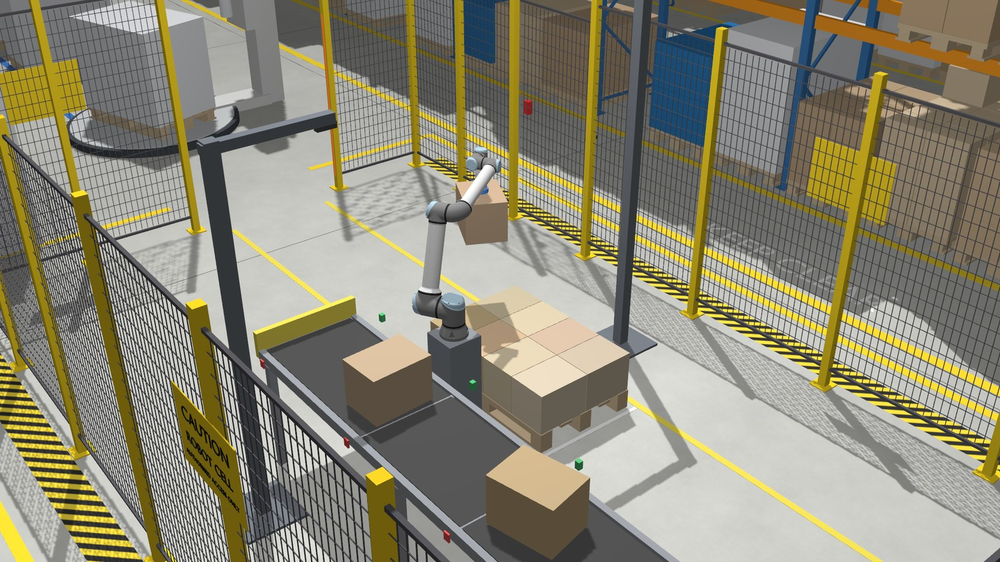</td>
  </tr>
  <tr>
    <td><code>world:=plain</code> (default)</td>
    <td><code>world:=warehouse</code></td>
  </tr>
</table>

## Quick start

Ubuntu 24.04, ROS 2 Jazzy, Gazebo Harmonic (gz-sim 8). Gazebo and RViz open by default;
`gui:=false` runs headless.

<details>
<summary><b>Setup</b> (once)</summary>

```bash
sudo apt install ros-jazzy-ur-description ros-jazzy-ur-simulation-gz ros-jazzy-ros-gz \
  ros-jazzy-gz-ros2-control ros-jazzy-ros2-controllers ros-jazzy-moveit python3-scipy \
  ros-jazzy-rviz-2d-overlay-plugins ros-jazzy-behaviortree-cpp
git clone https://github.com/JaisalJain/palletizer.git palletizer_ws
cd palletizer_ws
python3 -m venv --system-site-packages .venv && touch .venv/COLCON_IGNORE
source /opt/ros/jazzy/setup.bash
source .venv/bin/activate
pip install -r requirements.txt
python -m colcon build
source install/setup.bash
```
</details>

**Every new terminal** (from the `palletizer_ws` directory):

```bash
source /opt/ros/jazzy/setup.bash && source .venv/bin/activate && source install/setup.bash
```

## Try it

### Demo

```bash
ros2 launch palletizer_bringup palletizer.launch.py mode:=single_sku sku:=400x300x300
```

### Demo in the warehouse world

```bash
ros2 launch palletizer_bringup palletizer.launch.py mode:=single_sku sku:=400x300x300 world:=warehouse
```

### SKU change mid-stream (robot not told)

```bash
ros2 launch palletizer_bringup palletizer.launch.py mode:=single_sku order:="400x300x200:12, 600x400x300:20"
```

### Unseen carton on an unseen pallet

```bash
ros2 launch palletizer_bringup palletizer.launch.py mode:=single_sku sku:=347x253x219 pallets:=1140x760x150
```

### Interlocking over box count

```bash
ros2 launch palletizer_bringup palletizer.launch.py mode:=single_sku sku:=400x300x200 pattern_priority:=interlock
```

### Operator-confirmed exchanges, mixed pallet types

```bash
ros2 launch palletizer_bringup palletizer.launch.py mode:=single_sku sku:=520x320x250 pallets:="EUR,1000x800,HALF" exchange_mode:=operator
```

Then, in a second terminal: start the exchange (go), or close the pallet now:

```bash
ros2 service call /pallet/confirm_exchange std_srvs/srv/Trigger
```

```bash
ros2 service call /pallet/close std_srvs/srv/Trigger
```

### Mixed random boxes (v1 planners)

```bash
ros2 launch palletizer_bringup palletizer.launch.py mode:=mixed planner:=heuristic
```

### One pallet, then stop

```bash
ros2 launch palletizer_bringup palletizer.launch.py mode:=single_sku sku:=600x400x300 max_pallets:=1
```

Live behavior tree: Groot2 on port 1667.

<details>
<summary>More commands (manual mode, services, acceptance runs, offline tools)</summary>

```bash
# manual mode: everything except the orchestrator (a first pallet is delivered)
ros2 launch palletizer_bringup palletizer.launch.py
ros2 service call /box_spawner/spawn_box std_srvs/srv/Trigger
ros2 service call /perception/detect_box palletizer_interfaces/srv/DetectBox
ros2 service call /pallet_perception/measure_pallet palletizer_interfaces/srv/MeasurePallet
ros2 action send_goal /pallet_exchange palletizer_interfaces/action/PalletExchange "{}" -f
ros2 service call /conveyor_controller/resume std_srvs/srv/Trigger
ros2 service call /motion/park std_srvs/srv/Trigger
ros2 topic echo /pallet/status              # PalletStatus (transient local)
ros2 topic echo /pallet_perception/stack_events
ros2 topic echo /orchestrator/cycle_report

# acceptance runs / benchmark (fresh headless sim per run; tables go into docs/RESULTS.md)
ros2 run palletizer_orchestrator sku_runs                       # one pallet per catalog SKU
ros2 run palletizer_orchestrator sku_runs --name skuchange --order "400x300x200:10, 600x400x300:4"
ros2 run palletizer_orchestrator sku_runs --name unknown --sku 347x253x219 --pallets 1140x760x150
ros2 run palletizer_orchestrator benchmark --planners naive heuristic --seeds 1 2 3 4 --prefix v2bench

# offline tools
ros2 run palletizer_motion build_reachability_map    # station-area map; needs move_group running
ros2 run palletizer_packing pattern_report           # layer patterns of the catalog on EUR
tools/make_media.sh [--sim] [--rviz]                 # regenerate docs/media
```
SKU keys are the catalog entries in `cell_config.yaml` (`spawner.catalog`, read only by the
spawner); any other `LxWxH` in mm is taken literally. Pallet types: `EUR`, `1000x800`, `HALF`
or raw `LxWxH` mm (read only by the pallet exchanger).
</details>

## Results

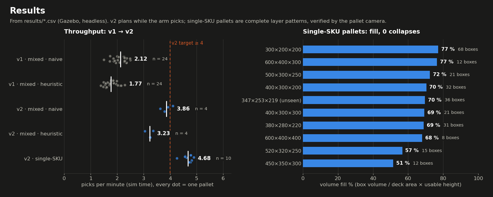

| | Result (Gazebo, headless) |
|---|---|
| Single-SKU pallets, unattended | 9/9 catalog SKUs + the unseen carton: pattern complete, 0 collapses, exchange done |
| Throughput | single-SKU 4.26–4.89 picks/min per pallet, 4.55–5.04 steady; mixed heuristic / naive 3.23 / 3.86 (v1: 1.77 / 2.12) |
| Box perception | 68/68 boxes, dims error ≤ 0.31 mm, grasp centre mean 0.03 mm |
| Pallet perception | 9/9 pallets, dims ≤ 3.1 mm, pose ≤ 0.5 mm / 0.17° |
| Placement check, stack monitoring | camera vs ground truth ≤ 0.67 mm; 40 / 30 mm shoves → SHIFT 39.9 / 29.9 mm |

Sensing and actuation in sim are ideal; expect several mm on hardware. Full tables, methods
and the v1 benchmark: **[docs/RESULTS.md](docs/RESULTS.md)**.

## Tests

```bash
python -m pytest src/palletizer_packing/test src/palletizer_perception/test \
  src/palletizer_tools/test/test_no_hardcoding.py          # unit tests, no sim (also in CI)
src/palletizer_tools/test/run_all.sh                       # clean build + sim test suite

SIM_ARGS="seed:=42" src/palletizer_tools/test/sim_ctl.sh start   # headless sim (add world:=warehouse) for:
ros2 run palletizer_perception eval_perception --n 60            # box perception vs ground truth
ros2 run palletizer_perception eval_pallet_perception            # pallet perception vs ground truth
ros2 run palletizer_orchestrator pick_place_test --n 20          # 20-box pick & place acceptance
src/palletizer_tools/test/sim_ctl.sh stop
```

## Packages

| Package | What it does |
|---|---|
| [`palletizer_bringup`](src/palletizer_bringup) | `cell_config.yaml` (all geometry and tunables) and the top-level launch |
| [`palletizer_description`](src/palletizer_description) | UR10e on a pedestal, suction gripper, F/T sensor, ros2_control |
| [`palletizer_gazebo`](src/palletizer_gazebo) | world (plain or warehouse), gz systems (suction, pallet mover, ground-truth poses), bridge, RViz config |
| [`palletizer_interfaces`](src/palletizer_interfaces) | messages, services and actions |
| [`palletizer_perception`](src/palletizer_perception) | box perception (conveyor) and pallet perception (pallet, height map, placements, stack) |
| [`palletizer_packing`](src/palletizer_packing) | ROS-free packing core (pattern planner, mixed planners, PyBullet check, gym env) + node |
| [`palletizer_motion`](src/palletizer_motion) | MoveIt 2 pick & place actions, planning scene, reachability map |
| [`palletizer_moveit_config`](src/palletizer_moveit_config) | SRDF, Pilz + OMPL pipelines |
| [`palletizer_orchestrator`](src/palletizer_orchestrator) | BehaviorTree.CPP orchestrator, metrics logger, benchmarks, media snapshots |
| [`palletizer_tools`](src/palletizer_tools) | simulated plant (spawner, conveyor, pallet exchanger), helpers, sim tests |

## Roadmap

- **Next: an RL packing planner** with robot-feasibility constraints (reachability, motion
  validity, stability), trained on the existing `PalletizingEnv` (gymnasium; built and tested,
  not trained yet).

## Author

**Jaisal K Jain** · [jaisaljain345@gmail.com](mailto:jaisaljain345@gmail.com)

Licensed under the [Apache License 2.0](LICENSE). If you use this work, see
[CITATION.cff](CITATION.cff).
